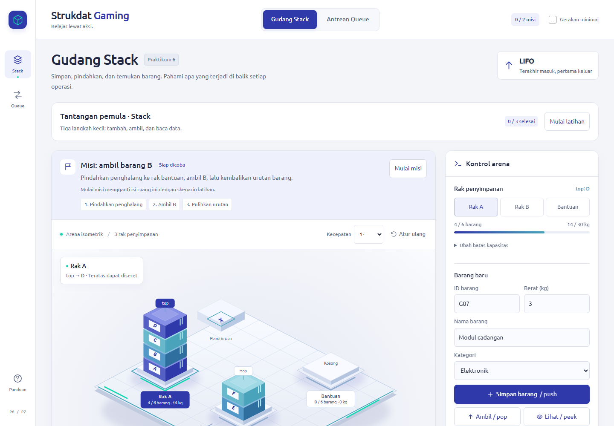

# Panduan Pengguna Strukdat Gaming

Strukdat Gaming membantu kamu mempelajari **Stack** dan **Queue** dengan memindahkan barang, mengatur antrean pasien, lalu mengamati perubahan linked-list dan kode. Kamu bisa bereksperimen bebas atau mengikuti dua misi terpandu.

Untuk pertama kali mencoba, ikuti urutan ini: **buka aplikasi → coba Tantangan pemula → selesaikan misi Stack → coba misi Queue → telusuri satu operasi di Bedah Eksekusi**.

## 1. Membuka aplikasi

Jika kamu sudah memiliki tautan aplikasi yang dapat diakses, buka tautan tersebut di browser. Untuk menjalankan proyek di komputer sendiri:

1. Pastikan Node.js sudah terpasang.
2. Buka terminal di folder `data-structure-lab`.
3. Jalankan:

   ```powershell
   node serve.js
   ```

4. Buka [Strukdat Gaming lokal](http://127.0.0.1:5174) di browser.
5. Biarkan terminal tetap berjalan selama aplikasi digunakan. Tekan `Ctrl+C` di terminal jika sudah selesai.

Tidak perlu menjalankan `npm install`. Buka aplikasi melalui alamat server tersebut, bukan dengan mengeklik dua kali `index.html`.

## 2. Mengenali tampilan



| Bagian | Kegunaan |
|---|---|
| **Stack / Queue** | Berpindah antara gudang barang dan antrean pasien. Di ponsel, tombolnya berada di navigasi bawah. |
| **Tantangan pemula** | Tiga latihan singkat untuk mengenali operasi dasar sebelum mencoba arena. |
| **Misi** | Menampilkan tujuan, progres, dan langkah berikutnya setelah misi dimulai. |
| **Arena isometrik** | Memilih rak, barang, jalur, atau pasien. |
| **Kontrol arena** | Menambah data, menjalankan operasi, dan mengatur simulasi. Di layar sempit, panel ini berada di bawah arena. |
| **Operasi cepat** | Menjalankan tindakan dekat arena tanpa mencari tombol di panel lengkap. |
| **Hasil operasi** | Menjelaskan tindakan yang berhasil atau alasan tindakan gagal. |
| **Di balik simulasi** | Menampilkan urutan node dan referensi linked-list saat ini. |
| **Bedah Eksekusi** | Menelusuri kode dan rekaman perubahan referensi dari operasi terakhir. |
| **Catatan eksperimen** | Melihat riwayat operasi yang telah dilakukan. |
| **Panduan** | Membuka bantuan ringkas di dalam aplikasi. |

Pada ponsel, gunakan **Tambah data & kontrol lengkap** di bawah arena untuk menuju formulir dan pengaturan. Geser dari lantai arena untuk menggulir halaman; menyentuh dan menggeser barang teratas digunakan untuk drag.

## Mulai dengan Tantangan pemula

Di bawah judul ruang, temukan **Tantangan pemula**, lalu klik **Mulai latihan**. Latihan menggunakan data sendiri sehingga tidak mengganti barang, pasien, misi, atau rekaman operasi di arena.

Setiap ruang menyediakan tiga langkah:

| Langkah | Pada ruang Stack | Pada ruang Queue |
|---|---|---|
| **Tambah data** | Pilih `push(C)` untuk menaruh C pada top. | Pilih `enqueue(C)` untuk menaruh C pada rear. |
| **Tebak yang keluar** | Tentukan data yang keluar jika `pop()` dijalankan. Amati aturan LIFO. | Tentukan data yang keluar jika `dequeue()` dijalankan. Amati aturan FIFO. |
| **Baca tanpa menghapus** | Pilih `peek()` dan pastikan jumlah data tidak berkurang. | Pilih `peek()` dan pastikan jumlah data tidak berkurang. |

Setelah menjawab, baca penjelasannya dan amati diagram. Jawaban salah tidak mengubah data latihan; kamu dapat langsung mencoba lagi. Jawaban benar menjalankan operasi pada struktur latihan. Klik **Lanjut ke langkah berikutnya** untuk meneruskan.

Setelah ketiga langkah selesai, klik **Coba di arena** untuk menerapkan konsep pada simulasi utama. **Tutup latihan** menyembunyikan bagian ini tanpa menghapus progres; **Ulangi latihan** mengembalikan latihan ruang tersebut ke awal. Stack dan Queue memiliki progres terpisah selama halaman terbuka. Latihan Queue memakai FIFO dasar, tanpa prioritas atau waktu pelayanan.

## 3. Menggunakan Gudang Stack

Stack mengikuti **LIFO — Last In, First Out**: barang yang terakhir masuk menjadi barang pertama yang keluar. Titik aksesnya disebut **top**, yaitu barang paling atas.

Pilih **Rak A**, **Rak B**, atau **Bantuan** melalui arena atau tombol pada panel kontrol. Semua operasi berikut berlaku pada rak yang sedang dipilih.

| Yang ingin dilakukan | Langkah |
|---|---|
| Menambah barang | Isi ID, berat, nama, dan kategori pada **Barang baru**, lalu klik **Simpan barang / push**. Barang masuk ke top. |
| Mengambil barang | Klik **Ambil / pop**. Hanya barang di top yang keluar dari arena. |
| Melihat barang teratas | Klik **Lihat / peek**. Data ditampilkan tanpa mengeluarkan barang. |
| Memeriksa rak kosong | Klik **Periksa isEmpty()**. `True` berarti rak kosong; `False` berarti masih ada barang. |
| Memindahkan barang | Pilih rak sumber, pilih **Rak tujuan**, lalu klik **Pindahkan**. Kamu juga bisa menyeret barang teratas ke rak tujuan. |
| Mencari barang | Isi ID pada **Cari ID barang…**, lalu klik **Cari**. Aplikasi memilih raknya dan menunjukkan jumlah penghalang jika barang tertimbun. |
| Mengubah kapasitas | Pilih rak, buka **Ubah batas kapasitas**, isi batas jumlah/berat, lalu klik **Simpan batas**. |

**Setelah transfer, pilihan rak otomatis berpindah ke rak tujuan. Pilih kembali rak sumber sebelum memindahkan barang berikutnya.**

Perhatikan juga aturan berikut:

- ID barang harus unik di seluruh rak, nama harus terisi, dan berat harus positif.
- Barang tertimbun tidak bisa langsung diambil atau diseret. Pindahkan penghalangnya terlebih dahulu.
- Jika kapasitas tujuan tidak cukup, transfer ditolak dan barang tetap berada di rak sumber.
- `pop` pada rak kosong menghasilkan `None` dan pesan **Underflow**; ini menunjukkan kondisi struktur kosong.

### Contoh: menyelesaikan misi “ambil barang B”

Klik **Mulai misi**. Jika muncul konfirmasi penggantian eksperimen, pilih **Ya, ganti skenario** untuk memuat susunan latihan.

Misi dimulai dengan Rak A berisi **A, B, C, D dari bawah ke atas**. Rak B dan Bantuan kosong. Targetnya adalah mengambil B, lalu mengembalikan barang lainnya ke urutan semula.

| Langkah | Tindakan | Rak A, bawah → atas | Bantuan, bawah → atas |
|---|---|---|---|
| Awal | Amati susunan misi. | A, B, C, D | Kosong |
| 1 | Pilih Rak A, tujuan Bantuan, lalu **Pindahkan** D. | A, B, C | D |
| 2 | Pilih kembali Rak A, tujuan Bantuan, lalu **Pindahkan** C. | A, B | D, C |
| 3 | Pilih Rak A, lalu **Ambil / pop** untuk mengeluarkan B. | A | D, C |
| 4 | Pilih Bantuan, tujuan Rak A, lalu **Pindahkan** C. | A, C | D |
| 5 | Pilih kembali Bantuan, tujuan Rak A, lalu **Pindahkan** D. | A, C, D | Kosong |

Status misi menjadi **Selesai**. Rak B dan Bantuan harus kosong. Pada diagram linked-list Rak A, urutan yang terlihat adalah:

```text
top → D → C → A → None
```

Diagram dibaca dari **top menuju dasar**, sehingga arahnya berlawanan dengan daftar susunan “bawah → atas” pada tabel.

Jika pertanyaan prediksi muncul, coba jawab sebelum menekan operasi. Jawaban salah bisa dicoba lagi dan tidak menghalangi penyelesaian misi.

## 4. Menggunakan Antrean Queue

Queue mengikuti **FIFO — First In, First Out**: data yang masuk lebih dahulu keluar lebih dahulu. Pasien masuk dari **rear** dan dipanggil dari **front**.

Ada dua mode:

| Mode | Aturan pemanggilan |
|---|---|
| **FIFO dasar** | Semua pasien berada dalam satu antrean dan dipanggil berdasarkan urutan masuk. |
| **Tiga prioritas** | Jalur diperiksa dengan urutan **Kritis → Darurat → Non-darurat**. FIFO tetap berlaku di dalam setiap jalur. |

Pada mode tiga prioritas, memilih jalur atau pasien hanya menentukan data yang sedang diamati. Tombol **Panggil berikutnya / dequeue** tetap memilih front dari jalur berprioritas tertinggi yang berisi pasien.

### Registrasi dan pelayanan

1. Pilih mode antrean yang ingin dipelajari.
2. Isi **ID pasien**, **Nama pasien**, dan **Tingkat kegawatan**, lalu klik **Daftarkan / enqueue**. Pada mode FIFO dasar, pilihan kegawatan dinonaktifkan.
3. Klik **Panggil berikutnya / dequeue** saat loket tersedia.
4. Pasien mulai dilayani selama **lima menit simulasi**. Tombol pemanggilan tidak tersedia selama pelayanan berlangsung.
5. Klik **1 menit** untuk memajukan jam satu menit, atau **Kejadian berikut** untuk langsung menyelesaikan pelayanan aktif. Tombol cepat **Selesaikan** di dekat arena melakukan tindakan yang sama.
6. Setelah loket tersedia, klik **Panggil berikutnya / dequeue** lagi untuk melayani pasien berikutnya.

**Jam tidak berjalan otomatis mengikuti waktu nyata.** Pelayanan yang sedang berlangsung juga tidak dihentikan ketika pasien dengan prioritas lebih tinggi datang; pasien tersebut dipertimbangkan pada pemanggilan berikutnya.

### Mengamati atau membatalkan antrean

- Pilih pasien pada arena atau daftar **Pasien dalam antrean** untuk melihat identitas, waktu kedatangan, dan estimasi tunggunya.
- Estimasi tunggu mengikuti kondisi antrean saat ini dan dapat berubah setelah ada registrasi atau pembatalan.
- **Lihat / peek** dan **isEmpty()** memeriksa jalur yang sedang dipilih, bukan keseluruhan tiga jalur.
- Untuk membatalkan pasien, pilih pasien yang masih menunggu, lalu klik **Batalkan antrean [ID]**. Pasien yang sedang dilayani tidak dapat dibatalkan.
- Laporan **Dilayani**, **Dibatalkan**, dan **Menunggu** diperbarui setelah tindakan yang relevan. Pasien dalam pelayanan ditampilkan terpisah dari jumlah menunggu.

### Contoh: menyelesaikan misi “prioritas tetap tertib”

1. Buka ruang **Queue**, lalu klik **Mulai misi**. Konfirmasikan jika diminta. Misi memuat P01 non-darurat serta P02 dan P03 darurat; P02 datang sebelum P03.
2. Pada registrasi, gunakan **ID P04**, nama **Dina**, dan tingkat **Kritis**, lalu klik **Daftarkan / enqueue**.
3. Klik **Panggil berikutnya / dequeue**. P04 dipanggil lebih dahulu karena berada di jalur kritis.
4. Klik **Kejadian berikut** untuk menyelesaikan pelayanan P04. Jam berubah dari 08.00 menjadi 08.05.
5. Klik **Panggil berikutnya / dequeue** lagi. P02 dipanggil sebelum P03 karena masuk lebih dahulu pada jalur darurat.
6. Pilih **P01**, lalu klik **Batalkan antrean P01**.

Status misi menjadi **Selesai**. Pada titik ini laporan menunjukkan **1 dilayani, 1 dibatalkan, dan 1 menunggu**. P02 masih dalam pelayanan, sedangkan P03 masih menunggu. Kamu dapat melanjutkan simulasi untuk melayani keduanya.

## 5. Membaca linked-list dan Bedah Eksekusi

Gunakan bagian **Di balik simulasi** untuk melihat keadaan struktur saat ini. Pilih rak atau jalur lain jika ingin melihat linked-list milik struktur tersebut.

| Istilah | Arti |
|---|---|
| **Node** | Objek yang menyimpan data satu barang atau pasien serta referensi `next`. |
| **top** | Referensi menuju node paling atas pada Stack. |
| **front** | Referensi menuju node terdepan pada Queue, yaitu tempat data keluar. |
| **rear** | Referensi menuju node paling belakang pada Queue, yaitu tempat data baru ditambahkan. |
| **next** | Referensi menuju node berikutnya dalam linked-list. |
| **None** | Tidak ada node yang ditunjuk oleh referensi tersebut. |

Untuk menelusuri perubahan satu operasi:

1. Jalankan **push**, **pop**, **enqueue**, atau **dequeue**.
2. Klik **Telusuri operasi ini di Bedah Eksekusi** pada hasil operasi, atau **Telusuri kode** di bagian linked-list.
3. Amati baris kode yang disorot, penjelasannya, serta panel **Node & referensi**.
4. Gunakan tombol baris sebelumnya/berikutnya untuk berpindah langkah, atau pilih langsung baris kode yang tersedia.
5. Klik **Putar** untuk menelusuri otomatis dan **Jeda** untuk berhenti. Baris bertanda **dilewati** adalah cabang yang tidak dijalankan pada operasi tersebut.

Misalnya pada `push`, amati urutannya: **node baru dibuat → next menunjuk top lama → top menunjuk node baru**.

Hal yang perlu dibedakan:

- **Arena dan diagram utama** menunjukkan hasil akhir operasi. **Bedah Eksekusi** menunjukkan rekaman perubahan per instruksi. Berpindah langkah rekaman tidak mengubah isi arena.
- **Rekaman model** tersedia untuk empat operasi dasar. Beberapa operasi lain menampilkan **Penjelasan algoritma**, tanpa rekaman node per instruksi.
- Transfer menampilkan dua fase: `push` ke rak tujuan, lalu `pop` dari sumber setelah tujuan tervalidasi.
- Kode Python ditampilkan untuk dipelajari dan dipadankan dengan model JavaScript. Kamu tidak mengetik atau menjalankan program Python di panel ini.
- N1, N2, dan seterusnya adalah identitas node lokal pada rekaman, bukan alamat RAM.
- Rekaman berfokus pada operasi terakhir. Beralih ruang mengosongkan rekaman yang sedang ditampilkan, tetapi isi arena masing-masing ruang tetap dipertahankan.

## 6. Kamera, animasi, dan keyboard

| Kontrol | Cara menggunakan |
|---|---|
| **Perbesar / Perkecil** | Tombol `+` dan `−` mengubah zoom arena antara 100–180%. |
| **Fokus objek** | Pilih rak atau pasien, lalu aktifkan tombol fokus untuk mendekatkan kamera ke pilihan. |
| **Kembalikan kamera** | Mengembalikan sudut pandang dan zoom awal tanpa mengubah data. |
| **Kecepatan** | Pilih 0.65×, 1×, atau 1.5× untuk mengatur kecepatan animasi dan pemutaran rekaman. |
| **Gerakan minimal** | Centang untuk mengurangi gerakan. Preferensi pengurangan gerak perangkat juga dihormati. |
| **Tab / Shift+Tab** | Berpindah antar kontrol. |
| **Enter / Spasi** | Mengaktifkan tombol atau memilih objek arena yang sedang mendapat fokus. |
| **Escape** | Membatalkan drag atau menutup dialog. Pada konfirmasi penggantian skenario, Escape mempertahankan eksperimen. |

## 7. Mengulang dan menjaga hasil eksperimen

- **Atur ulang** mengembalikan ruang aktif ke data contoh dan mengakhiri misinya.
- **Mulai misi / Ulangi misi** memuat ulang skenario misi ruang tersebut.
- Mengganti **FIFO dasar / Tiga prioritas** memuat ulang antrean, laporan, dan pelayanan pada ruang Queue.
- Jika eksperimen atau isian sudah berubah, aplikasi meminta konfirmasi. Pilih **Kembali ke eksperimen** untuk membatalkan atau **Ya, ganti skenario** untuk melanjutkan.
- **Bersihkan catatan** hanya menghapus riwayat operasi, tanpa mengosongkan rak atau antrean.

**Data hanya tersimpan selama tab digunakan. Memuat ulang atau menutup halaman akan menghilangkan eksperimen.** Simpan screenshot atau salin catatan penting sebelum keluar jika kamu membutuhkan bukti praktikum.

## 8. Jika menemui kendala

| Kendala | Yang dapat dilakukan |
|---|---|
| Aplikasi tidak terbuka dari berkas HTML | Jalankan `node serve.js`, lalu buka alamat server di bagian awal panduan. |
| Alamat lokal tidak dapat diakses | Pastikan terminal server masih berjalan dan buka alamat yang tercetak di terminal. |
| Muncul pesan port 5174 sudah digunakan | Coba buka alamat lokal terlebih dahulu; mungkin server proyek sudah berjalan di terminal lain. |
| Barang tidak bisa dipindahkan | Pastikan barang berada di top, rak tujuan berbeda dari sumber, dan kapasitas tujuan cukup. |
| Barang yang berpindah berbeda dari dugaan | Periksa rak sumber yang aktif dan penanda top. Memilih barang tertimbun tidak mengubah aturan LIFO. |
| ID ditolak | Gunakan ID yang belum dipakai. ID barang diperiksa di seluruh rak; ID pasien tidak boleh sama dengan pasien yang sedang menunggu atau dilayani. |
| Batas kapasitas tidak bisa disimpan | Jangan menetapkan batas yang lebih kecil daripada isi rak saat ini. Ambil atau pindahkan barang terlebih dahulu. |
| Pasien berikutnya tidak bisa dipanggil | Selesaikan pelayanan aktif dengan **Kejadian berikut** atau tombol cepat **Selesaikan**. |
| Jalur terpilih kosong tetapi masih ada pasien lain | `peek` dan `isEmpty()` memeriksa jalur terpilih. Pilih jalur lain untuk mengamatinya; pemanggilan tetap mengikuti aturan prioritas. |
| Misi Stack meminta diulang | Barang yang dibutuhkan mungkin sudah keluar dari arena atau urutannya tidak dapat dipulihkan dengan langkah saat ini. Gunakan **Ulangi misi** untuk memuat skenario awal. |
| Bedah Eksekusi belum memiliki rekaman node | Jalankan salah satu dari empat operasi dasar. Operasi lain dapat hanya menampilkan penjelasan algoritma. |

Untuk memastikan konsepnya dipahami, coba jelaskan dengan kata-katamu sendiri: mengapa D harus dipindahkan sebelum B bisa diambil, mengapa P04 mendahului P02, dan mengapa P02 tetap mendahului P03.
