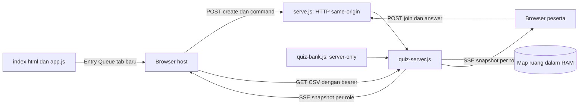
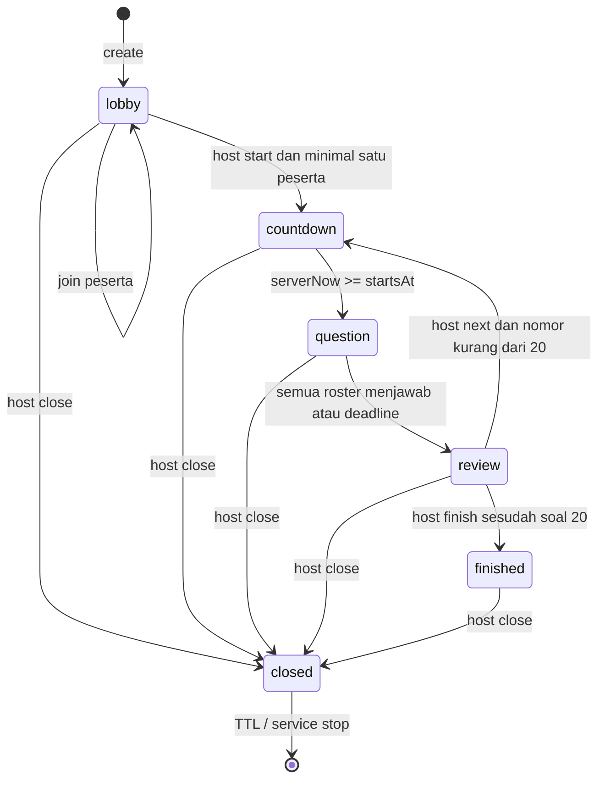

# Technical brief: Queue Live

Tanggal: 22 Oktober 2026, Asia/Jakarta. Status: kontrak implementasi V1 yang sudah ditulis; hasil pengujian tidak diasumsikan oleh dokumen ini. Riset pendukung berada di `../../reports/Kuis Queue multipemain.md`; langkah kerja dan verifikasi berada di [technical plan](QUEUE-LIVE-TECHNICAL-PLAN.md).

## 1. Hasil yang dituju dan batas lingkup

Queue Live menambah kuis kelas bersama pada prototipe Strukdat Gaming. Dosen membuat ruang, membagikan PIN atau tautan, menunggu peserta, lalu memandu 20 soal Queue. Semua peserta mengerjakan nomor yang sama, mendapat poin berdasarkan benar dan kecepatan, melihat pembahasan serta leaderboard bersama, dan mendapat hasil akhir. Host tidak menjadi pemain. Browser tetap memakai HTML/CSS/JavaScript standar dan server memakai Node.js ESM tanpa dependency eksternal baru.

| Termasuk V1 | Sengaja di luar V1 |
|---|---|
| Satu bank tetap 20 soal Queue, empat opsi, satu benar | Soal Stack, editor bank, soal buatan pengguna |
| Host-paced, lobby PIN enam digit, tautan gabung | Student-paced, homework, tim, turnamen |
| Skor server, timer, peringkat bersama, podium | Power-up, streak, musik, meme, bonus acak |
| Reconnect identitas tab, pembahasan per ronde dan akhir | Akun, riwayat permanen lintas ruang |
| CSV hasil akhir khusus host | Sinkronisasi LMS, nilai ujian resmi |
| Satu proses, RAM, LAN dan rancangan deploy HTTPS | Multi-instance, failover, database |

Manfaat utama adalah asesmen formatif setelah praktik Queue. Kompetisi kecepatan bukan bukti kemampuan akademik tunggal. Nickname dan peringkat terlihat oleh anggota ruang; peserta dianjurkan memakai alias yang dapat dikenali dosen tanpa wajib nama lengkap.

## 2. Dasar produk dan keputusan sendiri

Kedua tautan pengguna mengarah ke Wayground. Pembandingan Kahoot! dilakukan melalui bantuan resminya. Dokumentasi publik menunjukkan perilaku produk, bukan protokol internal atau arsitektur server mereka.

| Bukti produk | Keputusan Queue Live |
|---|---|
| Kahoot! memakai lobby/PIN, host start, distribusi jawaban, leaderboard dan podium | Lobby, kode, review + leaderboard, podium akhir |
| Wayground Teacher-Led memindahkan kelas bersama; Classic berada dalam Student-Paced | Hanya host-paced, tidak menyalin Classic sebagai mode sinkron |
| Kahoot! punya skor waktu maksimal 1.000; Wayground mendokumentasikan beberapa mode timer | Rumus sendiri 800–1.000 untuk benar, nol untuk salah/timeout |
| Wayground memisahkan accuracy dan session score | Benar/20 dan persentase akhir tetap terpisah dari skor |
| Kahoot! mendukung late join selama tidak dikunci | Identitas baru dikunci sejak countdown; reconnect identitas lama tetap boleh |
| Vendor menawarkan banyak tipe dan pengaturan | Satu tipe dan satu aturan skor untuk V1 |

Sumber: [Kahoot! live](https://support.kahoot.com/hc/en-us/articles/360039422694-How-to-host-a-live-kahoot), [tips hosting](https://support.kahoot.com/hc/en-us/articles/360039900153-Tips-for-hosting-a-live-game), [Wayground modes](https://help.wayground.com/support/solutions/articles/158000404918-live-session-modes-on-wayground), [Kahoot! scoring](https://support.kahoot.com/hc/en-us/articles/115002303908-How-points-work), [Wayground timer](https://help.wayground.com/support/solutions/articles/158000404053-grade-questions-using-timer), [Wayground accuracy](https://help.wayground.com/support/solutions/articles/158000404051-understand-how-accuracy-is-measured-on-wayground).

## 3. Peta perubahan dan dampak ke aplikasi lama

| Berkas/komponen | Tanggung jawab dan caller |
|---|---|
| `index.html` | Memuat `quiz.css`; bagian `#queue-quiz` menautkan `quiz.html` dalam tab baru dengan `rel=noopener` |
| `app.js` | Saat berpindah ruang, `#queue-quiz` terlihat hanya ketika `room === 'queue'` |
| `quiz.html` | Entry host/peserta, sesi, leaderboard, review akhir, dialog tutup ruang |
| `quiz.css` | Tampilan kuis dan entry Queue memakai token desain dari `styles.css` |
| `quiz-client.js` | Fetch API, parsing stream, sessionStorage, render state, timer, retry, CSV |
| `serve.js` | Mengimpor service kuis; API sebelum static allowlist; ekspor `createLabServer(options)` untuk pengujian; bind LAN |
| `quiz-server.js` | Ekspor `createQuizService({now})` dan `scoreAnswer`; lifecycle, validasi, auth, SSE, skor, CSV |
| `quiz-bank.js` | Ekspor server-only `queueQuiz`; tidak boleh diimpor browser atau ditambah ke allowlist |
| `package.json` | `start:lan` menjalankan `node serve.js --lan`; start dan test tetap memakai Node |
| `tests/` | Uji domain dan HTTP kuis ditambahkan di samping suite model/eksekusi/level/desain yang sudah ada |
| `README.md`, `docs/` | Cara LAN, keterbatasan state, aturan skor, deployment, rencana penerimaan |

`model.js`, `execution.js`, `levels.js`, dan `challenges.js` tetap sumber pembelajaran simulator; kuis tidak memutasi datanya. Mode kuis memiliki lifecycle terpisah sehingga timer/SSE tidak ikut berjalan di loop render arena. Refresh arena, penyelesaian level, warmup, dan berpindah Stack/Queue harus tetap diuji regresi. Tidak ada migrasi data pengguna atau penghapusan file lama; risiko perubahan terpusat pada static routing, entry Queue, dan stylesheet tambahan.

## 4. Arsitektur dan alur jaringan



Satu server menyediakan UI dan API pada origin sama. POST dipakai untuk aksi yang jarang; SSE membawa perubahan state. Client memakai fetch streaming agar dapat mengirim header Authorization; tidak memakai EventSource native, cookie, WebSocket, ataupun token pada query URL. SSE standar adalah satu arah; formatnya dipakai di atas response HTTP yang tetap terbuka. ([WHATWG SSE](https://html.spec.whatwg.org/multipage/server-sent-events.html), [MDN EventSource constructor](https://developer.mozilla.org/en-US/docs/Web/API/EventSource/EventSource))

Snapshot penuh dipilih karena fase/roster kelas kecil lebih sederhana dipulihkan dibanding event log. Setiap koneksi baru menerima keadaan sekarang. Tidak ada `id`, `Last-Event-ID` replay, atau riwayat event tahan restart. `revision` naik saat broadcast perubahan, termasuk koneksi/disconnect. Heartbeat mengirim snapshot tiap 15 detik tanpa menaikkan revision; client tetap mengkalibrasi clock pada revision sama. Revision lebih lama diabaikan, sehingga respons POST yang tiba setelah SSE baru tidak menurunkan tampilan.

Service memeriksa fase setiap 100 ms dan sebelum aksi. Buffer socket yang sudah melebihi 256 KiB diputus ketika hendak mengirim snapshot berikutnya. Ini pembatas sederhana; aplikasi belum menerapkan antrean pengiriman yang menunggu `drain` secara penuh. Maksimum dua stream per credential mencegah penumpukan salinan tab. Batas HTTP/1 SSE per browser/domain berbeda dari kapasitas kelas lintas perangkat; penggunaan banyak tab satu browser harus diperhitungkan. ([Node response.write](https://nodejs.org/api/http.html#responsewritechunk-encoding-callback), [MDN SSE](https://developer.mozilla.org/en-US/docs/Web/API/Server-sent_events/Using_server-sent_events))

## 5. Model data aktual

Model berikut menjelaskan objek runtime; bukan skema database atau seluruh payload publik.

```text
Room {
  pin: string(6), host: Member, players: Map<playerId, Player>,
  phase: lobby|countdown|question|review|finished|closed,
  index: -1..19, multiplier: 1|2|3, revision: integer,
  expiresAt: epochMs, startsAt: epochMs|null, deadline: epochMs|null
}
Member { id, role: host|player, token: hex(48), streams: Set<ServerResponse> }
Player extends Member {
  name, answers: Map<questionId, Answer>, score, correct, correctMs
}
Answer { choice: integer(0..3), correct: boolean, elapsedMs, points }
Question { id, topic, seconds, prompt, choices: string[4], answer: 0..3, explanation }
```

Token berasal dari `randomBytes(24)` dan menjadi 48 karakter hex atau 192 bit. ID pemain publik adalah potongan random terpisah sepanjang 12 hex; ID bukan credential. Host ber-ID `host`, tetapi tokennya tetap acak dan tidak pernah disertakan dalam leaderboard. Server hanya menyimpan SHA-256 dari token dan kode pemulihan; token mentah hanya ada di tab klien. Kode pemulihan host (192 bit) dikembalikan sekali saat create dan dapat menukar token host di tab baru. PIN dihasilkan dengan `randomInt(100000,1000000)` dan dicek unik di antara ruang aktif.

Tidak menjawab direpresentasikan sebagai tidak adanya entri pada `answers`; tidak ada objek timeout buatan. `correctMs` hanya menjumlah waktu jawaban benar. Pemain absen tidak mendapat bonus tie-break karena total skor dan jumlah benar diperbandingkan terlebih dahulu; jika skor, benar, dan waktu benar sama, mereka memang seri. Durasi room tetap tiga jam sejak dibuat dan tidak diperpanjang aktivitas, finish, atau reconnect. Menutup ruang mengubah fase menjadi `closed`; record tetap di RAM sampai expiry atau service ditutup.

Client menyimpan `{pin,token,role}` pada `sessionStorage['queue-live']`. Penyimpanan per tab memungkinkan host dan identitas pemain terpisah di tab berbeda, meski duplikasi tab dapat menyalin sessionStorage menurut perilaku browser. Tab yang memiliki token sama tetap identitas sama. Refresh mempertahankan sesi bila storage tersedia; storage yang dibatasi memunculkan pemberitahuan dan kehilangan tab tidak dijanjikan bisa dipulihkan.

## 6. Mesin status dan kendali



`review` sekaligus memuat pembahasan, distribusi, dan leaderboard; tidak ada fase reveal/leaderboard terpisah. Setiap ronde mempunyai countdown tiga detik. Host tidak dapat melompati soal atau menutup satu ronde lebih awal; `close` berarti menutup seluruh ruang dengan konfirmasi. Untuk menyelesaikan normal, host harus melewati semua 20 soal lalu menekan hasil akhir. Jika host offline, soal tetap berakhir, tetapi perpindahan nomor menunggu host.

Roster dikunci saat start dan tidak dihapus saat offline. Semua-answered berarti semua pemain dalam `room.players`, bukan hanya stream yang masih terhubung. Saat deadline berakhir, server beralih ke review meskipun peserta offline belum menjawab. Host command harus membawa revision terkini. Kehadiran pemain dapat mengubah revision sehingga aksi host yang bersamaan dengan reconnect mendapat 409; ini memerlukan sinkronisasi dan klik ulang, tidak membuat server melompat fase. Close bersifat final bagi permainan tetapi bukan penghapusan data segera.

## 7. Kontrak API

Semua endpoint berada di `/api/quiz`. Body POST harus JSON object, `Content-Type: application/json`, maksimal 4.096 byte. Endpoint terautentikasi memerlukan `Authorization: Bearer <48hex>`. Header token tidak boleh masuk URL, tautan peserta, error, ataupun log aplikasi. Respons JSON memakai `Cache-Control: no-store`.

| Method dan path | Hak | Body | Hasil |
|---|---|---|---|
| `POST /rooms` | Publik; header `Idempotency-Key` opsional (16–64 karakter) | `{ "multiplier": 1 }` | 201 `{pin,token,recoveryCode,role:"host",state}`; key yang sama mengembalikan respons pertama selama 10 menit |
| `POST /rooms/:pin/recover` | Publik, kode pemulihan 48 hex | `{ "code": "<48hex>" }` | 200 `{pin,token,role:"host",state}`; token host sebelumnya tidak berlaku |
| `GET /api/quiz/health` | Publik | Tidak ada | 200 `{ok:true}` (dipakai health check container) |
| `POST /rooms/:pin/join` | Publik, lobby | `{ "name": "Nara A2" }` | 201 `{pin,token,role:"player",state}` |
| `GET /rooms/:pin/state` | Anggota ruang | Tidak ada | 200 snapshot |
| `GET /rooms/:pin/events` | Anggota, maks. dua stream | Tidak ada | 200 SSE snapshot |
| `POST /rooms/:pin/command` | Host | `{ "command":"start", "revision":4 }` | 200 snapshot |
| `POST /rooms/:pin/answer` | Pemain | `{ "questionId":"q01", "choice":1 }` | 200 snapshot |
| `GET /rooms/:pin/results` | Host, fase finished | Tidak ada | 200 CSV UTF-8 dengan BOM |

Command yang dikenali hanya `start`, `next`, `finish`, dan `close`. Create/join tidak otomatis di-retry karena POST tidak idempoten secara bawaan; client menonaktifkan tombol selama request. Jika respons create/join hilang setelah server berhasil, klien yang mengirim ulang dengan `Idempotency-Key` sama menerima respons pertama selama 10 menit. Key hanya tersimpan selama proses hidup: create ulang setelah restart membuat ruang baru. Host yang kehilangan tab memakai kode pemulihan; peserta yang kehilangan token tidak punya jalur pemulihan. ([MDN POST](https://developer.mozilla.org/en-US/docs/Web/HTTP/Reference/Methods/POST))

Contoh snapshot peserta pada soal aktif, disingkat pada array leaderboard:

```json
{
  "pin": "123456", "phase": "question", "revision": 9,
  "serverNow": 1792640005000, "expiresAt": 1792650799000,
  "role": "player", "memberId": "12ab34cd56ef",
  "total": 20, "number": 1, "durationMultiplier": 1,
  "startsAt": 1792640003000, "deadline": 1792640028000,
  "answered": 1,
  "leaderboard": [{"id":"12ab34cd56ef","name":"Nara A2","score":0,"correct":0,"correctMs":0,"connected":true,"rank":1}],
  "me": { "score":0, "correct":0, "answer":{"choice":1} },
  "question": {
    "id":"q01", "topic":"FIFO", "prompt":"A masuk, lalu B, lalu C. Queue menggunakan aturan apa?",
    "choices":["Terakhir masuk, pertama keluar","Pertama masuk, pertama keluar","Nilai terbesar keluar dahulu","Data keluar secara acak"],
    "durationMs":25000
  }
}
```

Contoh ini ilustrasi bentuk kontrak, bukan rekaman benchmark. Pada `review`, `question` ditambah `answer` dan `explanation`; `distribution` berisi jumlah pemilih tiap opsi; `me.answer` juga mendapat `correct`, `elapsedMs`, dan `points`. Pada `finished`, `review` memuat seluruh 20 soal dengan kunci/penjelasan serta `mine` khusus peserta. Pada lobby/countdown, soal tidak dikirim. Saat `question`, bahkan host tidak menerima kunci, penjelasan, pilihan individu lain, ataupun hasil ronde aktif. `answered` tetap boleh meningkat; perubahan skor, benar, dan correctMs ronde aktif dikurangi dari snapshot leaderboard hingga review.

Format stream aktual:

```text
event: state
data: {"pin":"123456","phase":"question","revision":9,...}

```

Parser client mendukung framing yang diproduksi server ini: satu `data: ` JSON per event dengan pemisah baris kosong LF. Ini bukan parser SSE umum untuk arbitrary multiline payload. `TextDecoder` menangani potongan UTF-8, buffer maksimum satu MiB menahan input stream yang tidak selesai, dan AbortController menutup stream saat pindah sesi/tampilan. Reconnect mencoba lagi setelah 2,5 detik; 401/404 mengakhiri sesi lokal. POST/snapshot menggunakan timeout 12 detik dan setelah kegagalan client berusaha mengambil snapshot sebelum menawarkan retry.

| Status | Arti dan penanganan |
|---|---|
| 400 | JSON/body value, nama, pilihan, multiplier atau command tidak valid |
| 401 | Bearer tidak sah untuk ruang; credential baru diperlukan |
| 403 | Role salah atau asal cross-site; jangan retry tanpa memperbaiki konteks |
| 404 | Ruang hilang/kedaluwarsa atau endpoint tidak ada |
| 405 | Method tidak didukung |
| 409 | Fase/revision/soal berubah, jawaban terkunci, nama sudah ada atau ruang penuh |
| 413 / 415 | Body terlalu besar / content type tidak sesuai |
| 429 | Rate limit atau batas koneksi anggota; tunggu/tutup salinan tab |
| 503 | Dua puluh slot ruang sudah dipakai |
| 500 | Pesan umum kegagalan server; detail internal tidak dikirim |

## 8. Skor, deadline, urutan, dan race

```text
durationMs = question.seconds × 1000 × multiplier
elapsedMs = receivedAtServer − startsAt
boleh menerima jawaban baru hanya jika startsAt <= receivedAtServer < deadline
benar: 800 + round(200 × (1 − clamp(elapsedMs / durationMs, 0, 1)))
salah atau tidak menjawab: 0
rank: score DESC, correct DESC, correctMs ASC
```

`scoreAnswer` hanya menghitung angka dan clamp; penolakan jawaban terlambat dilakukan handler. Karena itu pemanggilan helper dengan elapsed di luar durasi bukan bukti jawaban tersebut diterima. Nilai benar bergerak dari maksimum teoritis 1.000 menuju 800, maksimum kelas 20.000. Exact tie berbagi rank 1,1,3. ID menjadi comparator terakhir hanya untuk urutan baris.

| Situasi | Keputusan aktual |
|---|---|
| Klik sebelum countdown selesai | Ditolak 409 |
| Request masuk tepat pada deadline | Ditolak 409; timer UI bukan otoritas |
| Event loop terlambat mengeksekusi tick | `advance()` dan pengecekan waktu request tetap menutup celah |
| Dua jawaban sama untuk soal sama | Entitas jawaban pertama dikembalikan, skor tidak bertambah |
| Pemain mengganti pilihan setelah diterima | Ditolak 409 |
| Respons POST hilang tetapi server menerima | Snapshot/retry identik memulihkan jawaban selama nomor belum berpindah |
| Retry questionId lama sesudah host next | Ditolak 409; nilai yang sudah diterima tetap tercatat |
| Jawaban terakhir bersamaan tick | Mutasi sinkron sesudah body dibaca, phase hanya satu nilai; tidak ada perhitungan skor ulang |
| Host double-click next / respons lama tiba belakangan | Revision/fase menolak perpindahan kedua; snapshot lama diabaikan |
| Peserta offline belum menjawab | Tetap roster, tunggu deadline; tidak otomatis reveal karena peserta online sudah selesai |
| Host offline | Deadline tetap berjalan, review menunggu host reconnect |

`receivedAt` diambil setelah body JSON selesai dibaca sehingga membuka koneksi lebih awal tidak memesan bonus waktu. Default clock server adalah `() => Math.floor(performance.timeOrigin + performance.now())`: epoch berbasis clock monotonic proses, bukan pembacaan jam dinding berulang. Uji dapat menyuntikkan clock melalui `now`. Timer UI mengestimasi serverNow + delta `performance.now()` sejak snapshot. Perubahan jam dinding setelah proses dimulai tidak mengubah durasi ronde; restart tetap menghilangkan state RAM. Latensi one-way tidak dikompensasi, jadi bonus mencakup keterlambatan jaringan. Aplikasi tidak menjanjikan keadilan milidetik lintas internet.

## 9. Blueprint bank 20 soal aktual

Huruf kunci di tabel ini untuk dosen/maintainer; dokumen tidak disajikan sebagai asset publik melalui server. Kunci tidak disembunyikan dari orang yang sudah memiliki repository, sehingga keamanan kompetisi terbatas pada akses aplikasi yang disajikan server.

| ID | Konsep dan kemampuan yang diukur | Detik 1× | Kunci | Inti pembahasan |
|---|---|---:|:---:|---|
| q01 | Mengenali FIFO dari A,B,C masuk | 25 | B | Yang masuk pertama keluar pertama |
| q02 | Memilih enqueue untuk tambah pasien | 25 | C | Tambah node melalui rear |
| q03 | dequeue A→B→C | 25 | A | Mengeluarkan A dari front |
| q04 | peek A→B tanpa mengubah isi | 25 | D | Hasil A, isi tetap |
| q05 | Inisialisasi Queue linked-list | 25 | B | Front dan rear sama-sama None |
| q06 | dequeue kosong sesuai praktikum | 25 | C | Mengembalikan None, bukan exception |
| q07 | enqueue node pertama | 30 | A | Front/rear menunjuk objek A sama |
| q08 | enqueue C setelah A→B | 30 | B | B.next=C, rear=C, front tetap A |
| q09 | dequeue satu-satunya node | 30 | C | Front/rear keduanya None |
| q10 | Trace enqueue A,B; dequeue; enqueue C | 40 | D | Isi akhir B→C |
| q11 | Trace dua dequeue terseling enqueue | 40 | A | Hasil A lalu B |
| q12 | isEmpty sesudah dua node dikeluarkan | 30 | C | True |
| q13 | Kompleksitas pointer front/rear | 35 | B | Enqueue/dequeue O(1), di luar rekaman visual |
| q14 | Pembatalan node tengah B pada A→B→C | 40 | D | A.next=C; pencarian O(n) |
| q15 | Pembatalan rear C pada A→B→C | 35 | A | Rear=B, B.next=None |
| q16 | Urutan prioritas stabil kritis/darurat/non | 40 | C | D→B→C→A, FIFO di tingkat sama |
| q17 | Pasien kritis saat A sedang dilayani | 35 | B | A selesai dahulu, tanpa interupsi |
| q18 | Tunggu C, A→B→C, loket kosong | 45 | D | 2×5=10 menit |
| q19 | Tunggu C, sisa A dua menit lalu B lima | 45 | A | 2+5=7 menit |
| q20 | Trace akhir dengan peek dan dequeue | 45 | C | Sisa C, peek sebelumnya B |

Total menjawab standar 670 detik; countdown total 60 detik; diskusi/lobby di luar angka ini. Pengali 2×/3× hanya mengalikan menjawab, bukan countdown. Urutan soal tetap dan pilihan tidak diacak. Tujuannya membangun konsep bertahap dan memudahkan pembahasan kelas; konsekuensinya sesi ulang dengan bank sama rentan hafalan. Prioritas/pelayanan adalah aturan simulator lanjutan, bukan definisi FIFO umum atau rekomendasi medis. Review dosen dan pilot kelas perlu memvalidasi istilah, tingkat kesulitan, dan waktu.

## 10. Keamanan dan privasi

| Ancaman | Kontrol sekarang | Batas tersisa / langkah berikut |
|---|---|---|
| Mengambil hak host lewat PIN | Token acak berbeda, hash di server, pemeriksaan role, kode pemulihan 192 bit | Pemegang kode pemulihan dapat merebut host; dosen harus menyimpannya dengan aman |
| Membaca kunci sebelum menjawab | Bank tidak di allowlist, snapshot tersaring, skor aktif ditahan | Repository/soal sesi sebelumnya tetap bisa diketahui |
| Mengubah skor/waktu dari browser | Server menghitung seluruhnya; payload hanya choice/id | Jaringan tetap memengaruhi waktu server |
| XSS lewat nickname | NFKC + trim, 2–24 unit string, tanpa control chars; escape HTML | Token sessionStorage dapat dicuri jika XSS lain muncul |
| Submit ganda / pilihan diganti | Map jawaban dan cek identik; role/fase/id | Retry lama setelah next ditolak, bukan replay receipt global |
| Abuse room/join | Limit create 20/IP/jam; join 120/IP/menit; member 180/menit | Bukan mitigasi DDoS; proxy/NAT perlu pengaturan deployment |
| Body besar / koneksi lambat | Body 4 KiB; max 2 stream/member; cap buffer | Slowloris/kapasitas host belum diuji khusus |
| Cross-site request | JSON, bearer, origin = host, penolakan sec-fetch-site cross-site, allowlist `QUIZ_HOSTS` | Wajib mengisi `QUIZ_HOSTS` dengan domain publik |
| Formula spreadsheet pada nama | CSV quoted, escape double quote, prefix pemicu formula | Variasi klien spreadsheet tetap perlu pemeriksaan manual |
| Kebocoran lintas pemain | Per-role snapshot, tidak mengirim token/jawaban individu lain | Nickname/skor/kehadiran sengaja dibagikan dalam ruang |
| Restart/crash | Snapshot JSON bila `QUIZ_DATA_FILE` diatur (token di-hash); TTL; CSV akhir | Perubahan dalam 200 ms terakhir dapat hilang saat crash mendadak; belum database |

Validasi panjang nama memakai panjang string JavaScript, bukan hitungan grapheme yang terlihat; emoji dapat menghabiskan beberapa unit. UI tidak boleh mengklaim 24 grapheme universal. Membandingkan Origin dengan Host request adalah perlindungan dasar same-origin, bukan autentikasi jaringan publik lengkap. Jangan menyalakan CORS wildcard atau membuka static wildcard demi deployment. OWASP merekomendasikan token acak, perlindungan transport, validasi trust boundary, dan pengurangan paparan data penyimpanan browser. ([OWASP session](https://cheatsheetseries.owasp.org/cheatsheets/Session_Management_Cheat_Sheet.html), [OWASP REST](https://cheatsheetseries.owasp.org/cheatsheets/REST_Security_Cheat_Sheet.html), [OWASP HTML5](https://cheatsheetseries.owasp.org/cheatsheets/HTML5_Security_Cheat_Sheet.html))

## 11. Aksesibilitas, UX, dan koneksi

Elemen yang sudah ada: skip link, `lang=id`, form berlabel, tombol asli, pilihan A/B/C/D beserta teks, penjelasan teks, caption/header tabel, region tabel yang dapat difokuskan/digulir keyboard, status koneksi, live region pesan, fokus judul/soal, dialog konfirmasi, dan grid ponsel. Timer memakai `role=timer` tanpa live region yang mengumumkan setiap tick. Host dapat memilih 2×/3× sebelum sesi; tidak ada perpanjangan per peserta atau timer-off di V1. Skema umum ini mengikuti perhatian keyboard/teks/zoom yang didokumentasikan Kahoot!, tetapi bukan klaim kepatuhan WCAG. ([Kahoot! accessibility](https://support.kahoot.com/hc/en-us/articles/115004537447-Does-Kahoot-meet-accessibility-standards))

Client mengunci pilihan pertama secara lokal saat menunggu server agar ketidakpastian jaringan tidak mendorong pilihan kedua. Jika snapshot belum membuktikan diterima, pengguna dapat mengirim ulang pilihan yang sama. Tombol jawaban/host disabled ketika offline atau request sedang berjalan, tetapi server tetap memvalidasi semua tindakan. Keluar dari tampilan hanya memutus stream dan menyediakan kembali ke sesi aktif; tidak menghapus pemain/skor atau mengakhiri room. Tutup ruang oleh host adalah tindakan berbeda dan memakai dialog.

Masih perlu verifikasi nyata: pembaca layar, urutan fokus setelah rerender, zoom 200%, kontras semua state, mobile landscape, keyboard dialog, reduced motion dari stylesheet bersama, latensi seluler, background tab, dan OS yang menangguhkan browser. Perubahan status setiap jawaban dapat merender ulang bagian halaman; dampaknya pada teknologi bantu tidak boleh diasumsikan baik tanpa uji.

## 12. Deployment dan operasi

```powershell
cd 'C:\Uner\Semester 7\Struktur Data\data-structure-lab'
npm start
# Untuk kelas satu jaringan:
npm run start:lan
```

Default adalah `127.0.0.1:5174`. Opsi LAN memakai `0.0.0.0:5174`; siswa membuka `http://<IP-LAN-host>:5174/quiz.html`. Variabel `HOST` dan `PORT` mengoverride default sesuai kebutuhan lingkungan. `0.0.0.0` adalah alamat bind, bukan alamat yang dibagikan. Contoh deployment satu proses pada port khusus:

```powershell
$env:HOST = '127.0.0.1'
$env:PORT = '5174'
node serve.js
```

Laptop host harus tetap menyala, Wi-Fi tidak mengisolasi klien, dan firewall hanya dibuka sesuai kebijakan jaringan privat pengguna. Jangan menganggap membuka file HTML atau memakai GitHub Pages menghasilkan multiplayer. HTTP LAN tidak mengenkripsi token; penggunaan internet memerlukan HTTPS.

Artefak deploy tersedia: `Dockerfile`, `docker-compose.yml`, `deploy/nginx.conf.template` (dirender dengan `QUIZ_HOST`), dan health route. Uji proxy dilakukan lokal dengan nginx 1.22 dan sertifikat self-signed; deployment ke domain publik belum dijalankan karena penyedia dan domain belum ditentukan. Target yang harus dipenuhi: satu proses Node jangka panjang di belakang reverse proxy TLS, origin sama untuk UI/API, buffering SSE dimatikan, timeout proxy lebih dari 15 detik heartbeat, dan proses dikelola agar tidak tidur. Untuk nginx, arahkan ke instance internal serta teruskan Host publik dengan konfigurasi tepercaya, `proxy_buffering off`, dan `proxy_read_timeout` yang memadai. Header aplikasi `X-Accel-Buffering:no` membantu tetapi harus diverifikasi pada proxy sebenarnya. Jangan menambah instance tanpa shared state/pubsub atau strategi room ownership. ([nginx buffering](https://nginx.org/en/docs/http/ngx_http_proxy_module.html#proxy_buffering))

Runbook kelas: mulai server → uji akses dari perangkat kedua → buat ruang → bagikan alamat benar/PIN → tunggu roster → pilih Start → bahas setiap review → selesai soal 20 → tampilkan hasil → unduh CSV → tutup ruang. Jika terputus, tunggu reconnect atau refresh tab yang sama. Jika 404 setelah TTL, atau setelah restart tanpa `QUIZ_DATA_FILE`, sesi hilang dan harus mulai baru. Jika tab host hilang, buka `quiz.html` di tab baru dan pakai panel "Pulihkan sebagai host" dengan kode ruang dan kode pemulihan; tab lama otomatis keluar. Tanpa kode pemulihan, jangan memulai ulang proses ketika masih berharap mengambil skor.

## 13. Kriteria penerimaan dan bukti

Fitur diterima ketika perjalanan host + minimal dua identitas peserta menyelesaikan 20 soal; jawaban benar/salah/timeout menghasilkan poin tepat; setiap perangkat menerima fase dan hasil sama; refresh mempertahankan identitas/jawaban; token salah tidak dapat memakai room; kunci tidak muncul sebelum review; CSV hanya tersedia bagi host setelah finish; dan simulator lama tetap berfungsi.

Batas kapasitas kode adalah 20 ruang × 60 pemain, bukan klaim 1.200 pemain telah diuji. Hasil run terakhir (22 Oktober 2026): `npm test` lulus 61/61, termasuk 60 peserta melalui HTTP pada seluruh 20 soal dengan clock uji dan token ruang lain yang ditolak 401 di semua endpoint anggota. Browser `tests/quiz-browser.cjs` lulus perjalanan host + dua browser context peserta, 20 ronde, refresh accepted-answer, offline/reload reconnect, Enter keyboard, escaping nickname HTML, CSV, cancel/confirm dialog, dan pemulihan host di context baru, tanpa pageerror. Lebar 320/390/768/1024/1440 tidak menyebabkan overflow mendatar halaman; screenshot berada di `screenshots/quiz/`. Paritas empat cuplikan DOCX dengan 12 state Python/JavaScript termasuk underflow lulus. Audit browser lama gagal pada teks SVG Stack 7,5 px di lebar 320 px; audit baseline HEAD index/app yang dimuat di memori gagal identik, sehingga ini dicatat sebagai isu lama di luar perubahan Queue Live. Tidak ada klaim 60 perangkat atau 60 SSE diuji serentak.

Beban sintetis 30 koneksi SSE × 20 ronde sudah lulus di loopback dan lewat nginx HTTPS lokal (rinciannya di technical plan §10). Target pilot berikutnya adalah dua perangkat LAN nyata lalu satu kelas nyata. Ukur jeda penerimaan snapshot, penggunaan memori, error, reconnect, dan kesetaraan hasil. Ambang awal seperti update LAN di bawah satu detik adalah target eksperimen, bukan hasil yang sudah dicapai. Dokumen ini tidak menyatakan load test produksi, deployment publik, audit aksesibilitas penuh, atau validasi dosen telah lulus.

## 14. Prioritas sesudah pilot

Sudah diterapkan: `QUIZ_HOSTS` dan `QUIZ_TRUST_PROXY`, Idempotency-Key create/join, kode pemulihan host, dan snapshot durable (`QUIZ_DATA_FILE`). Berikutnya: observabilitas tanpa token di log, load test lintas perangkat, dan penyimpanan multi-instance bila kelas membutuhkannya; lalu konten/topik lain sesuai kebutuhan. Clock monotonic proses sudah dipakai; cakupan uji clock dan scheduling tetap dapat ditambah jika operasional membutuhkan. Pindah ke WebSocket, Redis, framework, atau database tidak otomatis diperlukan untuk pilot satu kelas. Kebutuhan durabilitas dan jumlah proses, bukan kemiripan merek, seharusnya memicu perubahan arsitektur.
